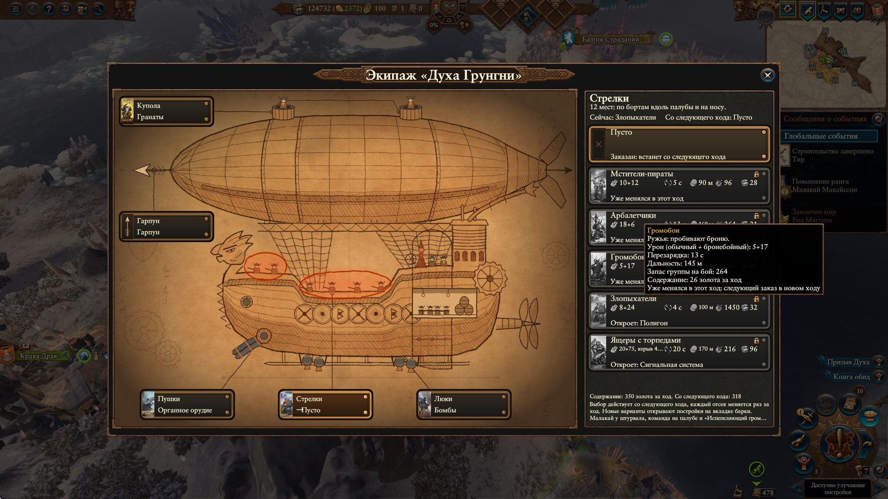
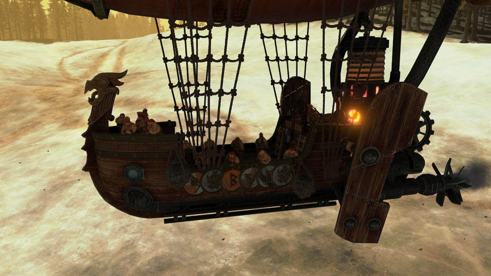
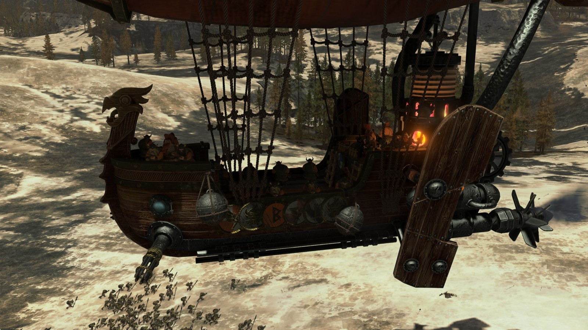
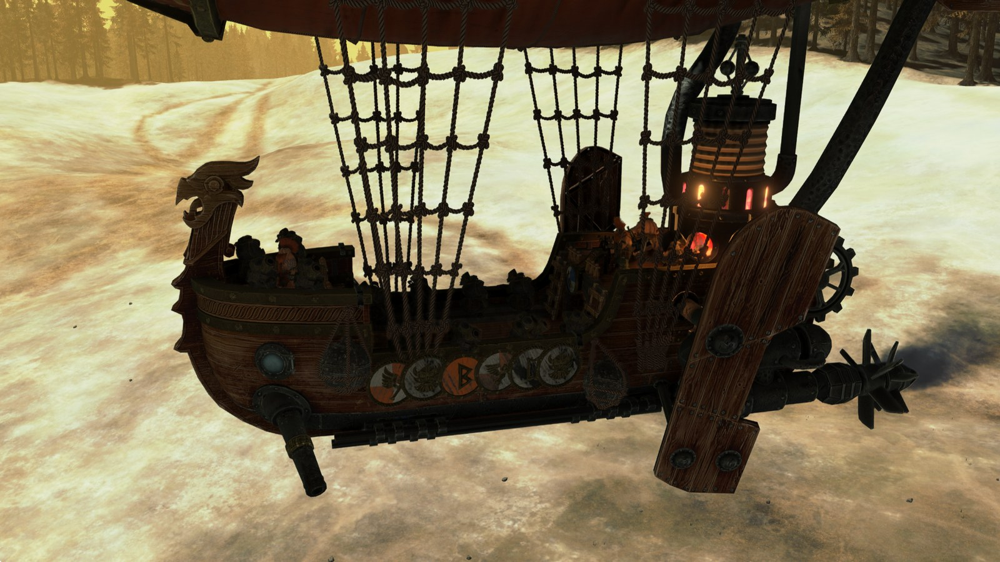
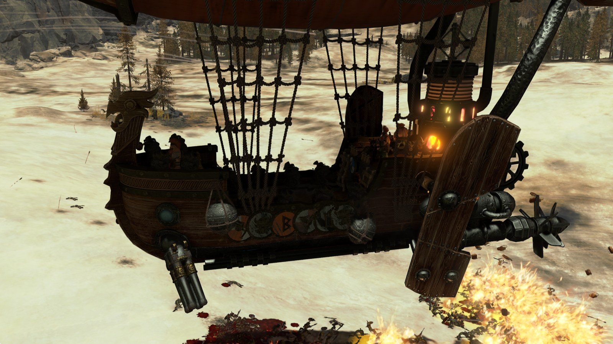

# Прогрессия экипажа

Реализовано, 04.11.2026: постройки ставят крепления и открывают варианты, игрок заказывает их в панели на следующий ход. Числа уровней и требования к корпусу взяты из `docs/design/progression-mount.md` и `docs/research/spirit-of-grungni-buildings.md`.

Двигатель, шары и обшивка отложены (`docs/design/barge-upgrades-ideas.md`). Здесь только экипаж. Постройки остаются с прежними эффектами и дополнительно открывают экипаж.

## Этапы

| Этап | Что нужно | Что получает игрок |
|---|---|---|
| 0. Пеший | Старт | Малакай пешком, стоковые навыки, стапель `airship_hull_1`, барки нет |
| 1. Барка | `airship_hull_2` | Барка с **Мстителями-пиратами с пистолями** на местах стрелков, остальные отсеки пусты |
| 2. Первое вооружение | `airship_hull_3`, начальные уровни зелёных цепочек | Пушка, бомбы, другие стрелки, команда на палубе |
| 3. Боевая барка | Средние уровни | Разные пушки и метатели |
| 4. Флагман | Верхние уровни, `airship_hull_5` | Органное орудие и торпеды |

## Постройка → отсек

| Цепочка | Логика | Уровень 1 | Уровень 2 | Уровень 3 |
|---|---|---|---|---|
| **Фюзеляж** `main_chain` | Основа барки | `hull_2`: барка и пираты | `hull_3`: **порты пушек**, `hull_4`: пушка барки | `hull_5`: огненные снаряды |
| **Тренировка экипажа** `army_ability_2` | Учим стрелков | Стрелки: Арбалетчики (слабее всех) | Стрелки: Громобои | Стрелки: Злопыхатели |
| **Радиус поддержки** `support_radius` | Дальняя поддержка | Стрелки: Ящеры с торпедами | Гарпун | |
| **Двигатели** `engines` | Пар и энергия для орудий | Пушки: Пулемёт | Пушки: Огненная пушка | Пушки: Органное орудие |
| **Грузовой трюм** `cargo_hold` | Боеприпасы | **Бомбовые отсеки** | Люки: бомбы | Люки: огненные бомбы |
| **Пивные краны** `beer_hall` | Весёлые метатели | **Вороньи гнёзда** | Купола: гранаты | Купола: топоры |

Итого 15 постройка → вариант. Железные ящеры с огнемётами исключены решением пользователя 03.11.2026. Серная пушка `brimstone` пока без постройки, только тестовой командой: решит пользователь.

Требования корпуса у уровней сохраняются. Боковым цепочкам, которые сейчас доступны с `hull_1`, поднимаем до `hull_2`.

## Как выбирается вариант

**У пушек, куполов и люков три состояния.** Нет крепления: постройки нет, обычный корабль без портов, гнёзд и отсеков (`none`). Крепление пусто: постройка есть, видны порт, гнёзда, двери; это вариант «Пусто» (`empty`). Оружие стоит. Постройка крепления ставит его сразу, само оружие нет. Вариант, открытый без своего крепления, виден серым с подсказкой «Нужны: порты пушек (постройка …)». Стрелкам крепления не нужны.

**Названия и подсказки.** Постройки из таблицы переименованы по тому, что дают (`building_names` в конфиге). У каждой зелёная строка в списке эффектов, текст строится из конфига: крепление, оружие и нужное крепление, экипаж.

**Постройка только открывает** оружие, в экипаже ничего не меняется. Сразу действуют `airship_hull_2` (пираты) и постройки креплений, поле `auto_active` в `data/crew_options.json`. Новый вариант ждёт выбора, на кнопке появляется ванильный значок «!».

**Заказ.** Выбор на панели встаёт в начале следующего хода фракции, бои этого хода идут со старым экипажем. Вместе с ним меняется и содержание. Панель показывает «Сейчас» и «Со следующего хода». Отсек меняется раз за ход, лимит в сейве и не обнуляется загрузкой. Выбор текущего варианта отменяет заказ, новый заказ в этот ход уже нельзя. Варианты тогда серые с подсказкой «Уже менялся в этот ход». Снос действует сразу, снимает заказ на закрытый вариант и лимит не тратит.

**Палуба** не выбор: команда и паб стоят всегда, пока есть барка, на чертеже тоже. Поле `always` группы `deck` в конфиге, данные группы целы: чтобы вернуть выбор, убрать поле и вернуть строку `beer_hall_1` в `buildings`.

**Гарпун** открывает `support_radius_2`, одна строка в `buildings`. До постройки и в положении «Пусто» нет ни способности, ни стрелы на носу шара. Под ИИ и без memreader Plus гарпун есть, как в стоке.

**Снос** закрывает вариант. Если он стоял на барке, группа переходит на вариант последней стоящей постройки этой группы, иначе на пустоту, и приходит одно сообщение. Если не стоял, в экипаже ничего не меняется. Открытое считается из сохранённого списка построек `mtb_crew_built`, отдельно не хранится. Правило «последняя построенная побеждает» убрано.

## Панель экипажа



- **Кнопка:** в круге у конца хода, вместе с кнопками фракционных механик (`hud_campaign` → `faction_buttons_docker` → `button_group_management`). Шаблон ванильный `round_hud_button_toggle`, круг раскладывает её сам. Значок свой, нарисована барка.
- **Кому:** только игрок за Малакая. Под ИИ и за другую фракцию кнопки нет. До `hull_2` и без memreader Plus кнопка серая, в подсказке причина.
- **Вид:** плоский чертёж барки на пергаменте в манере ванильной `ui/eventpics/dwf/spirit_of_grungni.png`, без 3D. Выноски пяти групп: карточка, название, текущий вариант. Отсеки на чертеже заполняются по выбору, выбранная группа обведена красным мелом. Щелчок по выноске или по самому отсеку выбирает группу.
- **Места на чертеже** взяты из модели и мест боя: вид сбоку `dwf_thunderbarge_01` и позиции бойцов из `men_s_flagship.txt`, нос слева. Купола на верху шара, спереди и сзади. Пушки в носу под иллюминатором. Стрелки: 2 на баке и 4 в поясе, на каждый борт. Люки: пара спереди и пара сзади. Кочегар и дозорный на кормовой палубе, паб под ней в разрезе. Плавники барки показаны контуром, иначе закрыли бы корму. Шар по длине сжат, чтобы влез в лист; по высоте чертёж тоже не в масштабе.
- **Справа:** все варианты группы и пусто: карточка, имя, урон, перезарядка, дальность, запас, строка описания. Закрытые серые, с замком и названием постройки. В подсказке подробности. Числа считаются при сборке из строк пака.
- **Выбор:** щелчок вызывает `tww3_mtb_crew.choose()`, это та же запись мест `apply`. Действует со следующего боя.
- **Закрытие:** крестик, Esc, щелчок мимо панели, конец хода, другая панель игры. Компонент уничтожается, ввод карты свободен.

**Как сделано:** свои `.twui.xml` в паке, как у MCT (`tools/crew_ui.py`); шрифты, значки и рамки игры. Рисунки делает `tools/crew_ui_art.py` (SVG, Chrome без окна, numpy), готовые PNG лежат в `data/ui/`, в паке 3 МБ. Код панели: `src/tww3_mtb_crew_ui.lua`. Новый вариант: поле `ui` в `data/crew_options.json`.

Панель проверена в запусках ниже, см. «Проверка панели». Снимки: `crew-panel.jpg`, `crew-panel-1280.jpg`, `crew-panel-button.jpg`, `crew-mount-states.jpg`, `crew-harpoon-nose.jpg`.

## Вопросы

Приняты советы, если пользователь не скажет иначе:

1. Стапель `hull_1` вместо пустой вкладки: да, скрыть попробуем позже.
2. После `hull_2` сажаем сразу, слезть можно в панели «Транспорт».
3. Цена `hull_2` стоковая.
4. ИИ-Малакай: стоковый экипаж и барка сразу.
5. Смертельный удар на барке остаётся.
6. Наём со стапеля: горняки, как сейчас.

## Результаты

Реализовано 03.11.2026, проверено в настоящих кампаниях, сначала `--igpu`, верхние уровни на RTX. Папки: `build/campaign/runs/`. Таблица из раздела «Постройка → отсек» лежит в `data/crew_options.json`, поле `buildings`: одна строка на привязку. Итоги всех сессий: `build/crew/cycle/results.jsonl`.

| Пункт | Итог | Доказательство |
|---|---|---|
| Стоковые навыки, Смертельный удар на барке | Да. Узлы смертельных ударов есть в дереве, строка отряда в паке. На барке в бою видна `determined_deathblow` | `*-cycle_prog_rest/log.txt`, `*-cycle_prog_load/read_l_loaded.txt` |
| Старт: пешком, только стапель | Да, двойное преобразование сработало на первом тике, с первой попытки | `*-cycle_prog_rest/log.txt`, `p_map_start.png`, `p_tab_start.png` |
| Боковые постройки до `hull_2` недоступны | Да, серые с требованием главной постройки | `20261103-151122-prog0/browser_start.png` |
| `hull_2`: настоящий приказ, событие, сразу на барке | Да. Приказ командой игры (та же, что у карточки), очки и золото скриптом | `*-cycle_prog_main/log.txt`, состояние `hull_2` |
| Пираты стреляют, пушки молчат | Да: 27 мест, 6 убитых, группа одна `rifles pirates`, 28 выстрелов | `results.jsonl`, `p_pirates` |
| Сойти и вернуться кликами, бой пешком | Да, отряд стоковый, кнопки вызова нет. Выбор держится после боя, хода, сейва и загрузки | `p_panel_off_list.png`, `p_foot_battle.png`, `prog_load` |
| Варианты цепочек в боях | `crew_weapons_1`, `engines_1`, `cargo_hold_1`, `beer_hall_1`, затем `support_radius_1`, `hull_3`, `beer_hall_2`: места 27 из 27, запас тратится по группам | `p_chains_1`, `p_chains_2` |
| Последняя построенная побеждает | Да: `support_radius_1` сменил арбалетчиков, `crew_weapons_2` сменил их снова | `r_chains_2`, `r_last_wins` |
| Снос | Откат к последней стоящей постройке группы, иначе к `start` (пусто). Снос занимает один ход. Высший уровень цепочки считает низшие стоящими | `r_demolish_rifles`, `r_demolish_beer` |
| Задания | «Призыв Духа» выполнилось от «Испепеляющего грома», задание на корпус тоже. Цепочка от «Призыва» не зависит (скрипт: счётчик ходов) | `*-cycle_prog_main/tww3_mtb_events.jsonl` |
| ИИ | Предмет с первого тика, `profile=ai`, стоковый экипаж, 27 мест, `barracks_1` на месте | `*-cycle_prog_ai` |
| Без memreader Plus | Выбор сохранён, ошибок нет, сообщение одно, запас тратится (0,98) | `*-cycle_prog_no_memreader` |

**Что не проверено или проверено слабо:**

- Экипаж без memreader Plus по местам не прочитан (память недоступна), но виден на снимках боя: `*-cycle_rtx_no_memreader/no_memreader_left.png`.
- ИИ-барка в армии без пушки летит и стреляет: 290 м, 70 убитых, `build/barge_checks/ai_rtx_noart2.txt`.
- **Закрыто на RTX:** все уровни таблицы прошли в бою, см. ниже.
- Вид текстов `hull_1`, `hull_2` на подсказке не снят, 3 попытки: подсказка требует настоящей мыши. Строка прочитана через `get_localised_string`.
- Вкладка навыков снята: `*-rtx_stages/s_skills_start.png`.
- Если Малакай потерял армию и на новой окажется ниже `hull_2`, пираты откатятся до новой постройки. Не проверено. В единственном таком случае корпус сохранился.

**Ограничения:**

- У `.loc` мода один текст на все языки, поэтому в описаниях `hull_1`, `hull_2` сначала русский, потом английский.
- Стапель `hull_1` остаётся на вкладке, `visible_in_ui` не пробовал.
- `build/v1` собирается с новым SHA-256: Смертельный удар вернулся и в отряд версии 1.

### Прогрессия до флагмана на RTX

Новая кампания, настоящие приказы, очки и золото скриптом, запуск `20261103-191048-cycle_rtx_stages`. Места 27 из 27 во всех боях. Запас тогда был старый (40/30/30/20, с постройками 48/36/36/24), поэтому группы кончались; числа выстрелов из `ammo_report`.

| Постройка | Вариант | Бой | Выстрелов |
|---|---|---|---:|
| `hull_2` | Пираты | `s_pirates` | 45 |
| `crew_weapons_1` | Арбалетчики | `s_first` | 45 |
| `engines_1` | Пулемёт | `s_first` | 32 |
| `cargo_hold_1` | Бомбы | `s_first` | 20 |
| `hull_3` | Стоковая пушка | `s_mid` | 17 |
| `beer_hall_2` | Гранаты | `s_mid` | 30 |
| `crew_weapons_2` | Громобои | `l_loaded` (ранее) | 22 |
| `crew_weapons_3` | Злопыхатели | `s_rakers_flaming` | 44 |
| `cargo_hold_2` | Огненные снаряды | `s_rakers_flaming` | 21 |
| `engines_2` | Огненная пушка | `s_torpedoes_flame_axes_fire` | 36 |
| `beer_hall_3` | Топоры | то же | 32 |
| `support_radius_2` тогда, теперь `support_radius_1` | Торпеды | то же | 49 |
| `cargo_hold_3` | Огненные бомбы | `s_flagship` | 24 |
| `engines_3` | Орган | `s_flagship` | 40 |
| `beer_hall_1` | Палуба | Не стреляет | Места 27 из 27 |

Новая привязка проверена отдельно: в запуске `*-cycle_rtx_final` `support_radius_1` дал `rifles=torpedoes`, а `tww3_mtb_crew.set("rifles", "irondrakes")` вернул false.

Заказанное сразу после боя иногда не строится, без ошибки: `hull_3`, `support_radius_1`, `beer_hall_2` на одном ходу, очки остались. Причину не доказал; предполагаю, что выбор персонажа после боя ещё не применён. `order()` в `tools/crew_cycle.py` теперь выбирает его и ждёт 3 с, после этого повторов не было.

Снимки этапов:    

Это снимки вариантов, выставленных командой на том же сейве: кампании с настоящими постройками сняты без скрытых панелей в `*-rtx_stages`.

## Проверка панели

04.11.2026, RTX, щелчки `SimulateLClick` внутри игры, новая кампания. Папки: `build/campaign/runs/`. Итоги шагов: `build/crew/cycle/results.jsonl`, сессии `panel_*`.

| Что | Итог | Доказательство |
|---|---|---|
| До `hull_2`: кнопка серая, не открывается | Да | `20261104-114811-cycle_panel_main`, `pn_no_barge`, `pn_click_inactive`, `n_map_no_barge.png` |
| `hull_2`: пираты, команда на палубе, больше ничего; бой 27 мест из 27 | Да | `pn_hull2`, `pn_state1` |
| Открытые и закрытые, подсказки, щелчок по закрытому не меняет | Да | `pn_open`, `pn_locked_tip`, `pn_click_locked` |
| Три состояния куполов, пушек, люков | Купола и люки да. Порт в состоянии 1 нет: см. ниже | `pn_state1`, `pn_state2`, `pn_state3`; `docs/research/img/crew-mount-states.jpg` |
| Оружие без крепления серое, «Нужны: порты пушек» | Да | `pn_needs_port`, `pn_needs_tip`, `pn_needs_refused` |
| Заказ: экипаж не меняется до нового хода, бой этого хода со старым | Да: `pn_same_turn` 27 мест, в бою старые | `20261104-111946-cycle_panel_main`, `pn_order_rifles`, `pn_same_turn`, `pn_order_done` |
| Второй заказ запрещён, другой отсек можно, отмена выбором текущего, лимит после отмены | Да | Там же: `pn_order_refused`, `pn_order_cannons`, `pn_order_back`, `pn_order_back_spent` |
| Новый ход снимает лимит | Да: стрелки, у которых лимит был потрачен на ходу 4, снова заказаны на ходу 11. Заказ на следующем же ходу отдельно не снят: шаг теста сорвался | `20261104-111946-cycle_panel_main`, `pn_order_doomed` |
| Сейв между заказом и ходом: заказ и лимит те же, новый ход выполняет | Да, сейв сделан командой из старого сейва (`panel_save`) | `20261104-122020-cycle_panel_load`, `pl_order_kept`, `pl_limit_kept`, `pl_next_turn` |
| Снос: заказ снят, вариант закрыт, лимит не тратится; откат сразу | Да: без крепления группа вернулась в `none` | `20261104-114811-cycle_panel_main`, `pn_order_gone`, `pn_demolish_active`, `n_message.png` |
| Содержание | Ход 9 → 10: доход 2528 − 186 = 2342, золото +2342. Ход 14 → 15: 2486 − 83 = 2403, золото +2403. Пешком 0 | `pn_gold_2`, `pn_gold_3`, `pn_on_foot`, `pn_back_on` |
| Гарпун | Нет до постройки, нет выключенный, есть включённый: способность по чтению боя, модель на снимках. Сейв держит | `pn_state1`, `pn_harpoon_off`, `pn_harpoon_on`, `pl_battle`; `crew-harpoon-nose.jpg` |
| Без memreader Plus | Кнопка серая, гарпун есть и в способностях, и на модели | `20261104-124602-cycle_panel_no_memreader`, `pm_*`, `pm_battle_nose.png` |
| Закрытие | Крестик и Esc-путь: компонента нет | `pn_closed`, `pn_esc` |

**Не проверено или не сделано:**

- **Порт пушки без креплений** закрыт круглой крышкой в цвет досок, а не чистым бортом: кольцо порта остаётся в модели под ней. Ниши люков закрыты пластинами. Снимок: `docs/research/img/crew-plain-hull.jpg`, запуск `20261104-143649-cycle_panel_plain`. Заплатки это отдельные слоты вида корпуса, поэтому «Испепеляющий гром» больше не затронут.
- **2560×1440 с UI 1,6.** В окне игра не выходит за 2048×1152: рабочий стол масштабирован 125 % (вывод из размера снимка). Корень интерфейса при 1280×720 равен 1600×900 (замер), при 2560×1440 и 1,6 должен быть таким же (вывод). Проверить можно `tools/play.py`.
- **Настоящие клавиша Esc и мышь.** Щелчки только через `SimulateLClick`, Esc через путь игры `cm:on_key_press_up`.
- **Вид подсказки кнопки в круге:** текст прочитан, на снимке не виден.
- **Без запуска:** ИИ-Малакай с панелью (код: `profile=player`, гарпун и содержание для него не включаются), конфедерация.
- **Содержание не видно в итогах дохода игры:** эффект с отрицательным значением не сработал, списание идёт скриптом.
- **Старые сессии** `prog_*`, `rtx_stages` ждут прежнее правило, их `expect` не сойдётся.

## Где продолжить

**Сделано:** панель, заказ, лимит, содержание, гарпун, крепления; ничего не закоммичено этой работой. Игра закрыта. Запуски и остальные проверки: `docs/research/barge-polish.md`, «Проверки на RTX».

**Вопросы пользователю:** `docs/questions-for-user.md`.

```text
py -3.14 tools/build.py
py -3.14 tools/crew_cycle.py session panel_main          новая кампания: кнопка, выбор, бои, снос, сейв
py -3.14 tools/crew_cycle.py session panel_load          сейв из panel_main
py -3.14 tools/crew_cycle.py session panel_no_memreader
py -3.14 tools/crew_cycle.py session panel_save          быстрый сейв с заказом для panel_load
py -3.14 tools/crew_cycle.py session panel_plain         вид корабля без креплений
py -3.10 tools/crew_ui_art.py --preview                  рисунки: data/ui/, просмотр build/crew_ui/preview.png
```
