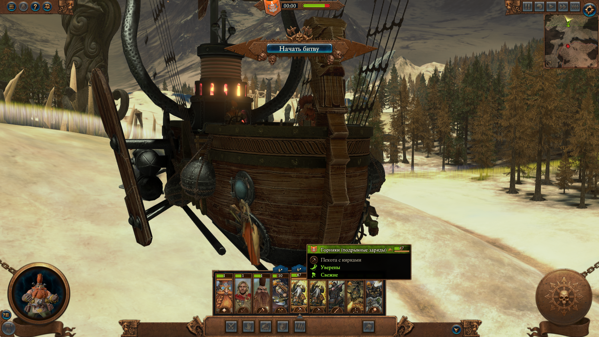
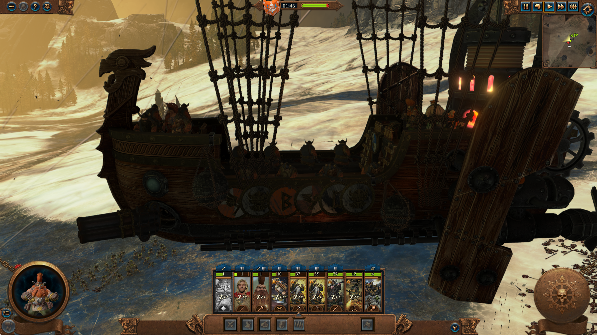

# Доводка барки: корпус, залп, топоры, дальний вид

Состояние на 03.11.2026. Всё проверено в настоящих боях кампании через `tools/crew_cycle.py` или в тестовых боях через `tools/run_weapons.py`.

## Главная находка: клоны Малакая

На всех боях кампании до этой правки **все стреляющие места показывали модель Малакая**, а не выбранный вариант. Вдоль борта стояли его клоны, у портов и люков торчали осколки: его же модель на скелете пушки или двери.

**Причина:** флаг `autonomous_rider_hero`. В бою кампании такое место отряда персонажа показывает модель самого персонажа. В тестовых боях из XML персонажа нет, поэтому там всё выглядело верно. Прежний подсчёт мест смотрел строку и оружие, а не модель, поэтому отличий не показал.

**Правка:** у всех своих строк `autonomous_rider_hero` = false. Стрельба не пострадала: 253 убитых в смешанном наборе. Вариант `stock` теперь тоже своя копия строки. Те же строки стоят в начальных записях отряда, поэтому и без memreader Plus клонов нет. Ванильные строки не менялись.

| До | После |
|---|---|
|  |  |

## Итоги

| Деталь | Решение | Итог | Снимок |
|---|---|---|---|
| Ниши люков | Пустой вариант — закрытые двери `door_left`, `door_right`: неподвижная модель на корне | Сделано, ниши закрыты | `polish-empty-below-before.png`, `-after.png` |
| Порт пушки | Пустой вариант — казённик стоковой пушки без ствола (`cap`) | Сделано | `polish-empty-left-before.png`, `-after.png` |
| Кольца куполов | Вырезаны из корпуса, стали моделью места `ap_cupola_front`. Шар под ними целый | Сделано: с экипажем кольца есть, пусто — их нет | `polish-rings-stock.png`, `polish-rings-empty.png` |
| Паб | Стол, лавки, бочки и фонари вырезаны, стали моделью места `ap_crew_barrel` | Сделано. Стойка и лестница у двери остались в корпусе | Запуск `p_hull`, снимок `hull_stock_pub_in` |
| Залп органа | Своя таблица анимации с 4 `FIRE_POS` и 4 вспышками, через 0,3 с | **По очереди, вспышки у разных дул** | `polish-volley-1.png`, `-2.png` |
| Залп пулемёта | 8 `FIRE_POS` через 0,12 с | По очереди | Бой `volley6` |
| Огненная пушка | 6 `FIRE_POS` через 0,2 с | По очереди | Бой `volley6` |
| Топоры | Тело без плаща, свой снаряд | Плащ убран, попадания выросли, но оружие слабое | Ниже |
| LOD | 4 уровня с расстояниями пушки | См. раздел 4 | `polish-far-*.png` |

## 1. Корпус

Предложенная схема работает: **один корпус, детали стали моделями мест.**

- Свои записи `mounts` и `variants` (`mtb_mnt_thunderbarge_grungni`), своя `variantmeshdefinition`, модель `warmachines/aircraft/dwf_thunderbarge/tww3_mtb_hull`. Обычная барка и стоковый Дух Грунгни используют ванильные файлы.
- Таблица анимации корпуса та же.
- 4 LOD по 3 меша, материалы Грунгни. Размер модели 6,8 МБ.
- Вырез задан в `data/hull_parts.json`: связный кусок, целиком лежащий в рамке. Команда `tools/hull_parts.py`. `tools/rmv2.py` теперь читает и `weighted4`.
- Треугольников вынесено по LOD: паб 2658 / 1402 / 506 / 400, кольца 248 / 232 / 160 / 128.

**Почему пустые места с заслонкой устроены иначе.** Строка с нормальной таблицей пушки или люка и без оружия всё равно стреляет оружием отряда: 26 убитых при «всё пусто» (запуск `p_hull`). Не помогло ни `battle_entity_stats` = пусто, ни `wh3_no_weapon`. Поэтому заслонка берёт таблицу, сущность и настройки скрытой строки, а модель неподвижна на корне `default_skeleton`. Итог: боезапас 100 %, 0 убитых.

**Что осталось видно при «всё пусто»:** фигура у носа, вопрос в `docs/questions-for-user.md`.

## 2. Залп по очереди

**Механизм.** Выстрелов за залп столько, сколько `FIRE_POS` в метаданных и разрешает `shots_per_volley`.

**Как подключить анимацию.** Замена файлов под ванильными именами не действует: бой `volley4`, у органа по-прежнему 1 снаряд. Новая таблица без `.animpack` тоже не грузится: бой `volley5`, орудие не стреляет. Работает новая таблица в файле `animations/database/battle/bin/!tww3_mtb_tables.animpack`, плюс строка `battle_animations_table`. Способ подсмотрен в устройстве мода из Мастерской: файлы в нём не брались, только формат. **Вероятно, так же можно убрать фигуру у носа**, это не проверял: вопрос пользователю остаётся открытым.

Код: `tools/cannon_meta.py`, данные: `volley` в `data/gun_models.json`. Копии снаряда больше не нужны: оружие ванильное.

Замер по Паровому танку, запись здоровья каждые 200 мс, бой `volley6`. Снаряд органа даёт по танку 76:

| Вариант | До | После |
|---|---|---|
| Орган | 1 снаряд или 4 разом | 4 шага с интервалом 0,2–0,4 с, по 76–155 (две пушки) |
| Пулемёт | 1 снаряд или 8 разом | Серия урона на 1 с |
| Огненная пушка | 1 снаряд или 6 разом | Серия на 1,4 с |
| Стоковая пушка | 1 снаряд | 1 снаряд, не изменилась |

**Ограничения.** Отдача общая на все стволы: анимация одна. Две пушки стреляют почти одновременно, но приказ у каждой свой. Точки вылета смещены на ±0,22 м в осях метаданных, при сильном наклоне ствола смещение примерное.

## 3. Топорометатели

**Плащ:** своя `data/vmd/cupola_axes.vmd`, части егеря без слота `cape`. На снимках плаща нет.

**Почему не попадали:** снаряд рассчитан на бросок с земли: `fixed_elevation` 45, траектория `dual_low_fixed`. С высоты купола топор улетал мимо.

| Попытка | Настройки снаряда | Убито за бой | Боезапас |
|---|---|---:|---:|
| До правки | Стоковые | 0 | 99,4 % |
| 1 | Траектория `fixed`, возвышение 5, дальность 100, скорость 40, 2 топора | 3 | 98,4 % |
| 2 | Скорость 55, разброс меньше (`calibration` 100 м, 1,5 м), точность +40, 3 топора, перезарядка 5 с | 12 и 5, в двух боях | 98,4 %, 97,7 % |
| Контроль | Стоковые гранаты | 44–49 | 98,3–98,5 % |

Считались убитые в общем бою с подлётом, цели разные. Гранаты бьют по площади, топор по одному. **Топоры теперь попадают, но в 4–9 раз слабее гранат.** Это вопрос баланса: можно поднять урон или число топоров. Точку броска не менял: она в анимации, а бросок виден со стоковыми гранатами. Сам полёт топора на снимках не пойман.

## 4. LOD и вид издалека

**Сделано.** У `organ` и `flame` оставлены 4 уровня с расстояниями стоковой пушки 20 / 40 / 60 / 10000 (`lods` в `data/gun_models.json`): 4238 / 2004 / 712 / 132 и 6370 / 1514 / 232 / 66 треугольников. `clatter` 562 / 434 / 253 / 153. Корпус и паб: расстояния и уровни корпуса.

**Подтверждено снимками:**

- **Малакай виден у штурвала** на 30, 60 и 120 м: `polish-far-wheel-60.png`, запуск `20261103-074018-cycle_p_far`, снимки `far_organ_late_wheel_30`, `_60`, `_120`. Прошлое сообщение, что его не видно, было ошибочным. На 250 м кадр снят мимо цели, вопрос там открыт.
- Барка на 100 м цела: `polish-far-100.png`.

**Подтверждено после правки клонов** на RTX: стволы и мигание, см. «Проверки на RTX».

## Запуски

Запусков игры по этой задаче до RTX: 16 (3 тестовых боя, 9 сессий доводки, 4 сессии полного цикла). Падений нет. Одну сессию `p_far` оборвал мой внешний `timeout`: игра закрылась, уборку сделал вручную, сейвы совпали. Поэтому `crew_cycle.py` нельзя оборачивать в `timeout`.

**Полный цикл пройден не до конца**, остановлен из-за выключения компьютера. Пройдены `a_new`, `b_load`, `c_rifles` и все 5 боёв `d_cannons`; сохранение в конце `d_cannons` прервано остановкой. Не пройдены `e_tops`, `f_no_memreader`, `g_bad_pattern`, `h_ai_empty`, `i_ai_stock`, `j_stress`. Значит, **работа без memreader после правки не проверена**. Обновление: позже эти сессии пройдены на встроенной карте, см. «Итоги проверок на Iris Xe».

| Сессия | Бой | Мест из 27 | Стреляет | Убито | Боезапас |
|---|---|---:|---|---:|---:|
| `a_new` | `r_thunderers` | 27 | да | 1 | 100.0 % |
| `b_load` | `r_pirates` | 27 | да | 9 | 100.0 % |
| `b_load` | `r_quarrellers` | 27 | да | 4 | 100.0 % |
| `b_load` | `r_rakers` | 27 | да | 42 | 100.0 % |
| `c_rifles` | `r_irondrakes` | 27 | да | 9 | 100.0 % |
| `c_rifles` | `r_torpedoes` | 27 | да | 14 | 100.0 % |
| `c_rifles` | `r_stock` | 27 | да | 20 | 100.0 % |
| `d_cannons` | `g_stock` | 27 | да | 44 | 99.4 % |
| `d_cannons` | `g_flaming` | 27 | да | 40 | 99.7 % |
| `d_cannons` | `g_organ` | 27 | да | 102 | 97.2 % |
| `d_cannons` | `g_clatter` | 27 | да | 1 | 96.6 % |
| `d_cannons` | `g_flame` | 27 | да | 35 | 95.9 % |

## Работа на встроенной видеокарте

RTX 5070 Ti вынута, пользователь решил пока работать на Intel Iris Xe. Настройки только на сессию: `--igpu` в `tools/crew_cycle.py` и `tools/run_game.py`, это 1280×720, масштаб рендера 0,5, всё на минимуме. Размер отрядов не менялся.

**Пробный запуск `smoke_igpu`: игра работает.** Запуск `20261103-103430-cycle_smoke_igpu`, 252 с от старта до закрытия, падений нет.

| Что | Итог |
|---|---|
| Запуск без NVIDIA | Игра сама выбрала встроенную карту, `gfx_gpu` с именем RTX не помешал. Другой режим рендера не понадобился |
| DLSS-мост | Загрузился, запуску не мешает. В `wh3_dlss.log` строки «DLSS initialized» теперь нет. Файлы моста не трогал |
| Загрузка сейва до карты | Около 73 с |
| Загрузка боя | Около 37 с |
| Скорость боя | **2,98 секунды боя за секунду** при заказанной скорости 3, то есть отставания нет |
| Логика | 27 мест из 27, стрельба есть, 56 убитых, возврат на карту |

**Кадры в секунду не измерены.** Таймер Lua срабатывал 134 раза в секунду, но нет доказательства, что он привязан к кадру. Поэтому это число не FPS. Для проверок логики важна скорость боя выше.

**Лимиты времени.** Масштаб не нужен: `--scale 1`, поэтому бои идут столько же, сколько раньше, и убитых можно сравнивать. Для запаса увеличен только жёсткий лимит сессии: `--limit-scale 1.5`.

**Окно игры: фокус убрать не удалось, помехи сведены к минимуму.** Пользователь работает за компьютером и разрешил запускать игру как можно реже, не прерывая разработку.

Игра идёт в окне и не поверх всех, но **при каждом запуске через 1–3 с после старта забирает фокус**. Это видно в `window.log` всех 6 запусков, где этот журнал вёлся с начала. `SW_SHOWNOACTIVATE` не помогает. Причина не доказана: вероятно, игра активирует себя сама, а Windows это разрешает.

| Мера | Итог |
|---|---|
| `capture.KeepBehind`: окно игры внизу стопки, без активации | Работает: окно не закрывает чужие. Фокус не возвращает |
| Запуск свёрнутым, `--minimized`, `SW_SHOWMINNOACTIVE` | Окно не мешает, но фокус всё равно уходит. С сейва работает, скорость боя та же. Снимки только если окно развернуть: иначе «no window» |
| То же для новой кампании | **Не работает:** в главном меню Lua не отвечает ни на одну команду. Запуск `20261103-111223-cycle_join_h_i` не дошёл до меню за 240 с. Для таких сессий `--minimized` теперь не применяется |
| Объединение сессий | `join_e_j_g` прошёл за один запуск. Объединить `h_ai_empty` и `i_ai_stock` не вышло: `bm:end_battle()` не закрыл бой с ИИ. Этот код убран |
| `LockSetForegroundWindow` | Не пробовал: действует на всю систему, в том числе на программы пользователя |

**Пока игра активна, нажатия клавиш пользователя уходят в неё**, даже если её окно свёрнуто или под другими окнами. Вернуть фокус можно щелчком по своему окну. В `join_e_j_g` фокус уходил к игре ещё несколько раз в 10:49–10:50, в `f_no_memreader` один раз в 11:10, в `i_ai_stock` один раз в 11:32. Причина неизвестна: это могли быть и щелчки пользователя.

Всего 7 запусков: пробный, `e_tops` (остановлен из-за фокуса, 83 с), `join_e_j_g`, `f_no_memreader`, `join_h_i` (не дошёл до меню, свёрнут), `join_h_i` (прошёл `h_ai_empty`, не смог перейти ко второму бою), `i_ai_stock`. Падений игры нет.

**Другой агент в той же игре.** Параллельно идёт `tools/ammo_run.py` (раздельный боезапас). Он тоже ждёт свободную игру и один раз занял её через секунду после моего запуска. Флаг `STOP` закрывает любую идущую сессию, поэтому `tools/crew_cycle.py` теперь ставит его, только если его собственная сессия ещё работает, и проверяет, что `tools/run_game.py` не отказал в запуске.

**Настройки пользователя.** `preferences.script.txt` совпадает с копией побайтно, включая `gfx_gpu`. Что изменилось в сравнении всей папки настроек и файлов в папке игры:

- `wh3_dlss.log` дописан самим мостом;
- реестр `HKCU\Software\The Creative Assembly\Warhammer3`: `timestamp_battle_started` и три новых `wh3_main_quote_*` = 1. Их меняет сама игра, ничего не откатываем;
- `battle_preferences/history.tilebattle_log` и `replays/Автосохранение.replay` игра изменила, `tools/run_game.py` вернул их из копии.

**После всех 7 запусков:**

- `preferences.script.txt` совпадает с копией побайтно, SHA-256 начинается с `439887cc`, `gfx_gpu` всё ещё RTX. Последнее сравнение сделано по копии, которую снял агент `ammo_run.py` в 11:36:23, в начале своего запуска, то есть уже после моего последнего. Сам файл на диске в тот момент был изменён его сессией: `tools/run_game.py` вернёт его после закрытия игры.
- Во всех 7 запусках `game_gone`, `prefs_restored` и `saves_identical` = true.
- **Реестр, ничего не откатываем.** Игра сама меняет `timestamp_battle_started` и `wh3_main_quote_*`. В сравнении появились ещё `prophash` и значения с именами лордов (`wh2_dlc13_lzd_cha_nakai_0` и подобные). Они появились после запусков с новой кампанией; часть могла записать и параллельная сессия `ammo_run.py`.
- `lua_mod_log.txt` в папке игры переписан игрой или модом. Новые файлы `resume/resume*` игры удалил `tools/run_game.py`.

В папке игры остался чужой файл `tww3_bai_sequence.txt` от 02.11. По правилам его не трогаю: нужно сообщить сессии соседнего проекта, сейчас она не в сети.

### Итоги проверок на Iris Xe

**Логика не сломалась: все 11 проверок прошли, расхождений, похожих на ошибку мода, нет.** Ошибок в коде мода не найдено, код мода не менялся. Сравнение с `results.before_polish.jsonl`, запуски `20261103-104718-cycle_join_e_j_g`, `20261103-110815-cycle_f_no_memreader`, `20261103-111827-cycle_join_h_i`, `20261103-113036-cycle_i_ai_stock`. Скорость боя во всех 2,97–3,0.

| Сессия | Бой | Мест, до → после | Стреляет, до → после | Убито, до → после | Боезапас, до → после | На карту |
|---|---|---|---|---:|---:|---|
| `e_tops` | `c_axes` | 27 → 27 | да → да | 0 → 2 | 99,4 → 99,5 % | да |
| `e_tops` | `c_stock` | 27 → 27 | да → да | 30 → 31 | 99,1 → 99,0 % | да |
| `e_tops` | `b_fire` | 27 → 27 | да → да | 160 → 143 | 99,4 → 99,6 % | да |
| `e_tops` | `b_stock` | 27 → 27 | да → да | 68 → 32 | 98,8 → 99,1 % | да |
| `e_tops` | `d_stock` | 27 → 27 | нет → нет | 0 → 0 | 100 → 100 % | да |
| `e_tops` | `all_empty` | 27 → 27 | нет → нет | 0 → 0 | 100 → 100 % | да |
| `f_no_memreader` | `no_memreader` | нет доступа к памяти, как и ожидается | да → да | 93 → 28 | 98,7 → 98,4 % | да |

| Сессия | До | После |
|---|---|---|
| `g_bad_pattern` | `stock: database pattern matched 0 times`, игра работает | То же |
| `h_ai_empty` | 27 мест, стоит на `near=295`, 0 убитых | 27 мест, стоит на `near=310`, 0 убитых |
| `i_ai_stock` | 27 мест, стоит на `near=295`, 0 убитых | То же |
| `j_stress` | 1000 применений, 0,1 с, 1001 запись, Lua 35104 → 33364 КБ | 1000 применений, 0,1 с, 1001 запись, Lua 35306 → 33422 КБ |

**Как читать:**

- **Убитые в `b_stock` и `no_memreader` упали вдвое и втрое, причина точно не установлена.** Я считаю это разбросом: расход боезапаса близок, а до правки `no_memreader` сам давал и 66, и 93. Бой заканчивается через заданное время после первого выстрела, поэтому один удачный залп сильно меняет счёт. Повторных боёв для проверки не делал, чтобы лишний раз не запускать игру.
- **Топоры:** 2 убитых против 31 у гранат, это подтверждает прежний вывод о слабом оружии.
- **Память** теперь 9–11 ГБ вместо 7–8: другая видеокарта и общая память, сравнивать нельзя.
- **`j_stress` и `g_bad_pattern`** шли после `e_tops` в том же запуске, а не загрузкой сейва. Поэтому загрузка `tww3_mtb_crew_e.save` с memreader в этом прогоне отдельно не проверена; без memreader он загрузился в `f_no_memreader`, выбор сохранился.
- **Сообщение игроку** при сбое на снимках не видно ни сейчас, ни в прогоне до правки. Статус верный, само окно сообщения не подтверждено. Снимка `no_memreader_map` нет: окно было свёрнуто.
- Строки `e_tops` / `loaded` и `join_h_i` / `loaded` в `results.jsonl` остались от неудачных запусков. У `h_ai_empty` в той же строке `session` записано `join_h_i`.

**Что ждало RTX:** закрыто, см. «Проверки на RTX».

## Проверки на RTX, 03.11.2026

Запуски `build/campaign/runs/`: `20261103-182616-cycle_rtx_far`, `184645-cycle_rtx_drive`, `191048-cycle_rtx_stages`, `200221`, `203705`, `211336-cycle_rtx_guns`, `205253-cycle_rtx_no_memreader`, `205851` и `210459-bc_ai_rtx_noart*`, `213546-ctrl_bow` (без мода), `214329-cycle_rtx_final`. Настройки: 1920 × 1080, текстуры и отряды на максимуме, тени, SSAO. **Идёт на RTX:** в логах `gpu 0 ... Warhammer3.exe | NVIDIA GeForce RTX 5070 Ti, 87 %, 6144 MiB`, в `wh3_dlss.log` снова `DLSS initialized`. После каждого запуска игры нет в `tasklist`, замок снят, `preferences.script.txt` с SHA-256 `439887cc`, `used_mods.txt` без изменений.

Первые два запуска не дошли до меню: **не был запущен Steam** (игра висела 7 минут без событий или сразу выходила с кодом 1). Падений игры нет.

### Дальний вид

**Модель в порядке, правка данных не нужна.** Стволы и Малакай на месте на 25, 40, 60, 90, 130, 200, 300 м, смены вида между уровнями нет. Снимки `far_*_gun_*`, `far_*_wheel_*`, `far_*_open_*`, `far_*_openw_*` в `*-rtx_drive`, вид `img/far-200m.jpg`.

**Мигания нет.** Серии 8–12 кадров через 0,1–0,2 с на 40, 60, 90, 200 м, штатный объектив: доля изменившихся пикселей между соседними кадрами 0,5–9 %, ровно, без одиночных выбросов (`burst.txt`). Единственные выбросы (45–77 %) дал сам `PrintWindow`: один кадр целиком чёрный. Теперь серия такой кадр снимает заново.

**Камеры стреляли мимо из-за узкого объектива при движущейся барке.** Новый инструмент `tools/far_view.py`: прицел на точку места, а не на угадывание, объектив считается от расстояния, барка останавливается приказом, прицел повторяется прямо перед кадром, панели скрыты (`bm:enable_cinematic_ui`). Наборы видов в `data/crew_cycle.json`: `far_views`, `close_guns`, `close_top`. Осталось: на дальних длиннофокусных кадрах из боя с сильным разворотом барка изредка выходит из кадра (2 кадра из примерно 100, `far_flame_wheel_300`). Штатный объектив не страдает.

**Не использовать** `bm:modify_battle_speed(0.1)`: после него встроенные функции стали возвращать саму функцию вместо числа (`alliances:count()`), бой пришлось закрывать без кнопок. Причина не выяснена, совпало с первым запуском чтения мест из памяти; без обоих сбой не повторялся.

### Убитые: регрессии нет

Убитых решает разброс, а не видеокарта и не мод.

| Бой | До доводки (RTX) | Iris Xe | RTX, сейчас |
|---|---:|---:|---:|
| `b_stock` | 68 | 32 | 37, 1, 7, 36, 43 |
| `b_fire` | 160 | 143 | 201 |
| `no_memreader` | 66, 93 | 28 | 44, 67 |

Бой кончается через 12 с после первого выстрела, а бомба бьёт только то, что под баркой: 18 бомб дали 1 убитого, 9 бомб дали 37. Строго доказать нельзя: сборка «до доводки» заново не запускалась.

### Пулемёт, орган, огненная и серная пушки

| Орудие | Было | Стало |
|---|---|---|
| Пулемёт | Один короткий ствол бомбовоза (`turret_0`, 214 вершин, это его высший уровень, длина 0,64 м) × 2,2 на задней части пушки | **6 тонких стволов** (ствол органа без казённика, поперёк × 0,42, вдоль × 1,82), кожух из трубы стоковой пушки, 2 хомута из колец органа, шар в порту |
| Орган | 4 ствола висели перед пустым портом | Шар стоковой пушки в порту и кожух вокруг казёнников, стволы теперь на кости `cannon_1` |
| Огненная пушка | То же: без опоры | То же: шар и кожух |
| Серная пушка | Нет | Новый вариант `brimstone`: ствол автожира, растянутый вдоль оси, на шаре и кожухе |

Снимки: `img/guns-clatter-and-organ.jpg` (пулемёт сбоку, спереди, в наведении, орган), все в `*-20261103-200221-cycle_rtx_guns/gun_*`. Сборка из частей: поле `parts` и `mount` в `data/gun_models.json`, `tools/gun_models.py`. Blender не понадобился.

**Огненная пушка по таблицам стреляет снарядами, не потоком:** `is_beam_launch_burst` = false, 6 отдельных зарядов в залпе, скорость 40. Кадра с летящим зарядом нет. **Серная пушка в бою выглядит плохо:** снаряды летят длинными цветными шлейфами из точки перед дулом, расходятся веером, часть уходит вверх, на барку не ложатся (`gun_brimstone_far_burst_16_f0.png`). Здоровье барки не изменилось, но барка в этих тестах неуязвима, так что самоожог не проверен. 5 выстрелов, 0 убитых. Строка постройки не привязана, включается только командой `tww3_mtb_crew.set("cannons", "brimstone")`.

**Откуда шлейфы со снимков 8, 9 и 13:** почти наверняка **Железные ящеры с огнемётами**: по времени снимков шли бой `s_mid` и бой `gun_drakes`, выбор `rifles=irondrakes`. У их снаряда `is_beam_launch_burst` = true, как и у серной пушки. Другие снаряды с осколками: только `wh3_dlc25_dwf_thunderbarge_fire_bomb` (4 осколка на полусферу), у огненных снарядов разрыва с осколками нет. По решению пользователя вариант убран, см. ниже.

**Непрерывный огонь: не вышло, вернул залпы.** Опыт `clatter2`: 8 выстрелов через 0,4 с, перезарядка 2,8 с. По журналу выстрелов: 5 выстрелов (больше анимация не вмещает, около 2 с), пауза 4,5–5 с, цикл 6,5–7 с. Обычный пулемёт: 8 выстрелов за 1 с, пауза 7–8 с. Значит, очередь можно растянуть максимум до 2 с, а разрыв около 4,5 с диктует сам движок. Как сделать: `volley.spacing` в `data/gun_models.json` и `projectile.base_reload_time` у варианта. Код опыта убран.

### Боезапас от ванильных отрядов

`primary_ammo` ванильного отряда считается на одного бойца или орудие: у органа 96 на орудие при 4 стволах в залпе, то есть 24 залпа. Поэтому запас группы = запас образца × наши места. У стоковых групп барки запас общий и почти бесконечный: 50 × 29 у стрелков, 40 × 29 на 8 стреляющих мест у остальных. Поле `ammo` и источник `ammo_source` в `data/crew_options.json`.

| Вариант | Образец | На бойца или орудие (размер отряда) | Наши места | Выстрелов | Секунд огня по таблице |
|---|---|---:|---:|---:|---:|
| Пираты | `wh3_dlc25_dwf_inf_slayer_pirates` | 8 (80) | 12 | 96 | 40 |
| Арбалетчики | `wh_main_dwf_inf_quarrellers_0` | 22 (80) | 12 | 264 | 286 |
| Громобои | `wh_main_dwf_inf_thunderers_0` | 22 (80) | 12 | 264 | 286 |
| Ящеры с торпедами | `wh_main_dwf_inf_irondrakes_2` | 18 (28) | 12 | 216 | 360 |
| Злопыхатели, стоковые стрелки | Барка, второй пул | 50 × 29 | 12 | 1450 | 241 |
| Стоковая пушка, огненные снаряды | Барка, первый пул | 145 на место | 2 | 290 | 1595 |
| Орган | `wh_main_dwf_art_organ_gun` | 96 (4 орудия) | 2 | 192 | 288 |
| Пулемёт | `wh_main_dwf_veh_gyrobomber` | 240 (4 машины) | 2 | 480 | 180–225 |
| Огненная пушка | `wh_main_dwf_art_flame_cannon` | 150 (4 орудия) | 2 | 300 | 250 |
| Серная пушка | `wh_main_dwf_veh_gyrocopter_1` | 60 (12 машин) | 2 | 120 | 135 |
| Гранаты | Барка, первый пул | 145 на место | 2 | 290 | Не считал: перезарядку не прочитал |
| Топоры | `wh_dlc06_dwf_inf_rangers_1` | 12 (80) | 2 | 24 | 96 |
| Бомбы, огненные бомбы | Барка, первый пул | 145 на место | 4 | 580 | 1450 |

Проверено в боях: орган 168 из 192 после 24 выстрелов, пулемёт 376 из 480 после 104, торпеды 195 из 216 после 21, пираты 67 из 96 после 29, стоковая пушка 285 из 290 после 5, топоры 19 из 24 после 5. **Группа до нуля с новыми числами не доведена:** остановку при нуле доказывают прежние бои с малым запасом. Запас при постройках выше на 20 % (36 вместо 30), этот множитель пришёл не из моих чисел, причину не искал.

### Обход реализма

| Что | Итог |
|---|---|
| Купола | **Исправлено.** Метатель стоял снаружи кольца. Кольцо было в 1,2 раза меньше: корпус рисуется с масштабом 1,2 из строки варианта, модель места нет. Заднее кольцо ещё стояло мимо своего бойца. Теперь: масштаб 1,2, центр по бойцу, сдвиг заднего на 2 м (`data/hull_parts.json`). Снимки `stage_flagship_cupolas_22.png`, `walk_mix_rear_top_8.png`. Сверено с контролем без мода `ctrl_both_22.png`: кольца на тех же местах, того же размера. В стоке боец тоже стоит у края кольца |
| Паб | Масштаб 1,2 ему вредит: стол уезжает от бойцов. Оставлен как был, снимок `pub_stock_pub_in.png` |
| Порт | Шар закрывает пустоту вокруг ствола у всех орудий, кроме `stock` и `flaming`: у них стоковая модель |
| Откат | Стволы на `cannon_1`, кожух на `cannon_0`, шар неподвижен. Откат кадрами отдельно **не замерял** |
| Стрелки, заслонки | По снимкам `walk_*` явных проблем нет |

### Голова гнома у носа (снимок 12)

**Не воспроизвелось.** Сцена с гномом у носа: 10, 30, 60, 100, 200 м сбоку, 6–100 м сзади и сверху. Голова видна на всех снимках, где он в кадре (`gun_bow_bow_tele_*`, `gun_bow2_bow_top_15.png`), контроль без мода тоже (`ctrl_side_*`). На снимке пользователя за ним стоят тёмные фигуры в броне, так что возможно перекрытие. Это только предположение, причина не установлена. Сам гном — стоковый `ANIMATED_PROP`, мод его не меняет. Вариант с огнемётчиками, где это снято, теперь убран.

### ИИ-барка, снимки

- **Под ИИ работает.** `bc_ai_rtx_noart2`, армия без пушки, игрок стоит: барка прошла около 290 м, вступила в бой, убила 70, здоровье 12580 → 3631, запас 0,97. Лог `build/barge_checks/ai_rtx_noart2.txt`. За первые 90 с (`rtx_noart`) она прошла 152 м и ещё не стреляла.
- **Без memreader Plus:** экипаж виден, стоковый: `*-cycle_rtx_no_memreader/no_memreader_left.png`, `_right.png`.
- **Вкладка построек на старте:** `*-rtx_stages/s_hover0.png`, цепочка корпуса с ценой 2, 4, 8, 16.
- **Вкладка навыков, стоковое дерево:** `*-rtx_stages/s_skills_start.png`.
- **Подсказка постройки не снята, 3 попытки.** `SimulateMouseOn` на слоте и карточке открывает список цепочки, но не подсказку, `GetTooltipText` пуст. Нужна настоящая мышь, а её трогать нельзя. Текст прочитан в логе через `get_localised_string`.

## Где продолжить

Игра закрыта, замков нет. `py -3.14 tools/build.py` собирает мод. Вопросы утром: `docs/questions-for-user.md`. Запускать только при работающем Steam.

```text
py -3.14 tools/crew_cycle.py session rtx_guns     держит игру открытой; бои снаружи, через Session.battle
py -3.14 tools/far_view.py sweep имя --seat ap_captain --az -15 --el 25 --fov 40 --dists 40,90,200
```

Копия прежних итогов полного цикла: `build/crew/cycle/results.before_polish.jsonl`.

## Что нужно решить

- Фигура у носа: пробовать ли `.animpack`, раз этот способ заработал. Не проверялось.
- Сила топоров.
- `docs/design/modular-crew.md` не правил. Его таблицы и снимки до этой правки показывали клонов Малакая, вид вариантов надо переоценить.
- При «всё пусто» стойка и лестница у двери паба остаются в корпусе: достаточно ли этого.
