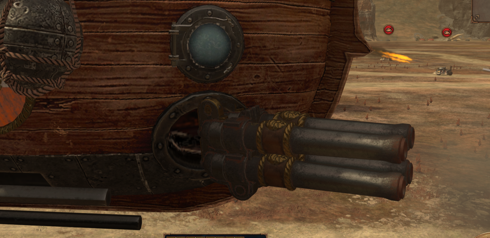
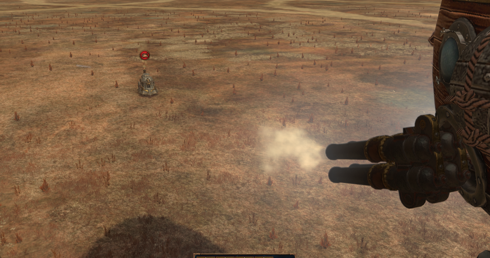

# Органное орудие на местах пушек: прототип

Состояние на 03.11.2026. Всё проверено в настоящей игре. Штатный отряд и обычная сборка не менялись, сборка отдельная: `tools/build_weapons.py`.

**Итог: работает.** 4 ствола двумя рядами 2 × 2, как на снимке пользователя, стоят на месте пушки барки, наводятся, откатываются и стреляют.




## Ответы

| Вопрос | Ответ | Чем подтверждено |
|---|---|---|
| Можно собрать модель и подключить? | **Да**, своим скриптом, без AssetEditor и Blender | Бои `guns`, `guns2`, падений нет |
| Анимация на `zeppelin01_cannon` | Подходит как есть. Наведение идёт через кость `root`, откат через `cannon_0`. Вся модель привязана к `cannon_0` | Кадры `g_organ__m_*`, разбор `.anim` |
| Клиппинг с корпусом | Казённик уходит в круглый порт борта, это выглядит нормально. Первая версия задевала корпус курками под иллюминатором: курки убраны | `guns` против `guns2` |
| Откуда вылет | Вспышка и дым у дульных срезов: дуло стоит на z = 2,75, вспышка задана на расстоянии 2,25 м от кости. Точка вылета не правилась | `img/organ-gun-firing.png` |
| Стреляет ли как надо | **Со стоковым оружием нет:** из `shots_per_volley` = 4 вылетает **один** снаряд. С копией `shots_per_volley` = 1, `projectile_number` = 4, `spread` = 3 вылетает 4 | Замер ниже |

### Замер залпа

Цель: стоящий Паровой танк, у него одна сущность. Запись здоровья каждые 200 мс в `events.jsonl`, бои `volley2`, `volley3`, `guns2`. Органный снаряд 22 + 68 даёт по танку 77. На барке 2 пушки, перезарядка около 13 с.

| Вариант | Потеря за перезарядку | Снарядов на пушку |
|---|---:|---:|
| `wh_main_dwf_organ_gun` как есть (`shots_per_volley` = 4) | 152–155 | **1** |
| Копия с `burst_size` = 4, `burst_shot_delay` = 0,25 | 145–153 | **1**, настройка не помогла |
| Копия с `projectile_number` = 4, `spread` = 3 | 448–609 | **до 4**, при 2 пушках максимум 616 |

То же у других орудий: пулемёт с `shots_per_volley` = 8 и огнемёт с 6 дают по одному снаряду. Значит, правило общее: **на анимации с одной точкой вылета выходит один снаряд**. Рабочая замена во всех случаях одна: `projectile_number`.

Снаряды одного залпа вылетают одновременно. Чтобы они шли по очереди из разных стволов, нужна своя `.anm.meta` с 4 `FIRE_POS`. Это не делал.

## Как устроена анимация

Разобран `cannon_fire_01.anim` и родственные (формат: AssetEditor, `Shared/GameFiles/Animation/AnimationFile.cs`).

| Кость | Что делает при выстреле |
|---|---|
| `animroot` | Постоянный поворот на 180° вокруг Y |
| `root` | Наводка по слоту: вперёд, влево, вниз |
| `cannon_0` | Откат до 0,65 м в части слотов, при выстреле вперёд почти стоит |
| `cannon_1` | Телескоп: передняя часть ствола заезжает на 0,9 м внутрь задней |

Поэтому модель привязана к `cannon_0`: она поворачивается и откатывается, но не складывается телескопом.

## Как повторить

```text
py -3.14 tools/gun_models.py organ
py -3.14 tools/build_weapons.py --battle guns2
py -3.14 tools/run_weapons.py --label guns2 --timeout 240
py -3.14 tools/report_weapons.py
```

- `tools/rmv2.py`: чтение и запись `rigid_model_v2` версий 7 и 8, только стандартная библиотека. Проверка на файлах игры: при чтении и записи без правок меняются только рамки в заголовках мешей (пересчитываются).
- `tools/gun_models.py` и `data/gun_models.json`: какие кости взять, куда поставить каждую группу, какой масштаб. Берутся все LOD исходной модели. Модель собирается из ванильных частей, файлы модов не используются.
- `data/weapon_variants.json`: запись `g_organ_one` (модель, оружие, снаряд) и отряд с тем же именем.

Числа модели: кости стволов 10–13, масштаб 1,2, дуло на z = 2,75, оси рядов ±0,22 м. Рама `turret_pivot_0` и курки 14–17 отброшены.

| Модель | Источник | Треугольники по LOD | Сравнение |
|---|---|---|---|
| `organ` | `dwf_organ_gun_01` | 4238 / 3020 / 2004 / 712 / 132 | Стоковая пушка 504 в LOD 0 |
| `clatter` | `dwf_gyrobomber_01`, кость `turret_0`, масштаб 2,2, плюс задняя часть стоковой пушки как основание | 562 / 434 / 253 / 153 | |
| `flame` | `dwf_flame_cannon`, кости 6, 10, 11, масштаб 0,85 | 6370 / 3870 / 1514 / 649 / 232 / 66 | |

Этот же способ подошёл для пулемёта бомбовоза и огненной пушки: одна запись в JSON на вариант.

## Что не сработало

| Попытка | Что вышло |
|---|---|
| Одна персоналия на все места группы | Модель и оружие получает только одно место, остальные остаются как были. Нужна своя персоналия на каждое место, как у стоковой барки |
| `burst_size` вместо числа снарядов | Без эффекта |
| Пулемёт только из кости `turret_0` | Короткая деталь висела в воздухе рядом с портом. Решение: задняя часть стоковой пушки как основание |
| Вражеская техника на расстановке | Игра ставит её по-своему. В тестах цель ставится скриптом через `teleport_to_location` |

## Что осталось

- Настоящий залп по очереди: своя таблица анимации и `.anm.meta` с 4 `FIRE_POS`.
- Отдача общая на все стволы. Курков нет.
- LOD не сокращались: 2 пушки по 4,2 тыс. треугольников против 504 у стоковой. На дальней камере специально не смотрел.
- Баланс: дальность 300 против 100 у стоковой пушки, расход общего запаса снарядов.
- В кампании с модульной системой не проверялось.

Снимки: `build/weapons/runs/20261102-*-guns`, `*-guns2`, `*-volley2`, `*-volley3`.
